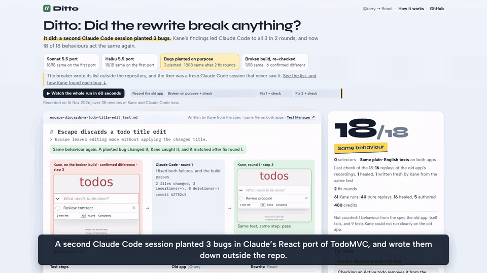
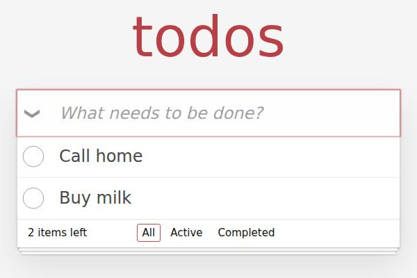
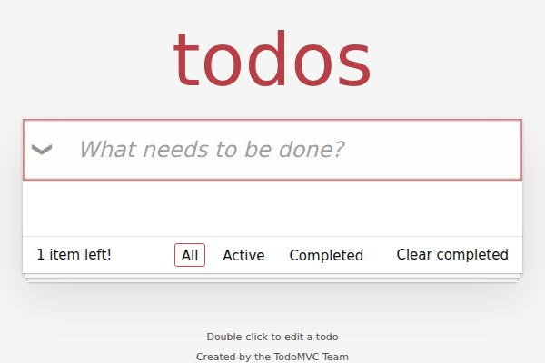
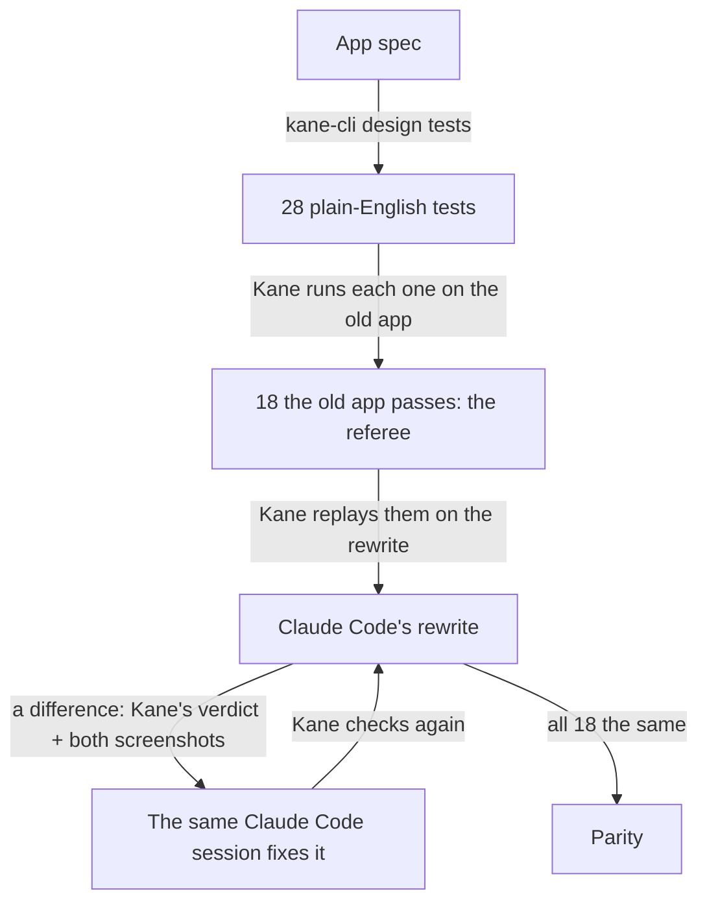

# Ditto: Did the rewrite break anything?

[](https://github.com/itssaharsh/ditto/actions/workflows/ci.yml) [](https://itssaharsh.github.io/ditto/) [](LICENSE)

**Let an AI agent rewrite your frontend. Kane CLI runs the same plain-English tests on the old app and on the rewrite, and sends every difference back to the agent until the two behave the same.**

[Live replay of the runs](https://itssaharsh.github.io/ditto/) · [The React port Claude wrote](https://github.com/itssaharsh/todomvc-react-port) · [The planted-bug commits](https://github.com/itssaharsh/todomvc-react-port/commits/ditto/mutation-check) · [How it works](docs/how-it-works.md) · [Testing](docs/testing.md)



**In 30 seconds**

- **What:** an AI agent (Claude Code) rewrites a frontend; Kane CLI checks that users wouldn't notice, and every difference it confirms goes back to the agent until there are none.
- **How:** Kane designs plain-English tests from the app's spec, the old app is the referee (only tests it passes count), and the old app's recordings replay on the rewrite.
- **Proof:** a second agent planted 3 bugs and Kane's findings led Claude Code to all 3; that run exposed a flaw in Ditto's own rules, which was fixed and re-measured. Replayed on five official TodoMVC builds and scored against 14 bugs someone else had reported upstream, Kane confirmed 4 of the 10 its tests reach and found 1 nobody had reported. Its misses showed what a replay can't see, and Ditto now checks for that too. Every number on this page comes from a recorded run.

## For judges (60 seconds)

1. Open the [live replay](https://itssaharsh.github.io/ditto/). It opens on a planted bug: Kane's verdict on the broken build, Claude's fix, and the same test passing, with Kane's screenshot of both apps at every step. Click a screenshot to enlarge it.
2. Scroll to **3 bugs planted on purpose**: the breaker's list beside what Kane reported each round, and the rule this run made Ditto change. The **Broken build, re-checked** tab shows that rule at work on the same broken build.
3. Press **Watch the whole run in 60 seconds** to see it happen in order.
4. Switch to **Sonnet 5.5 port** for the first port, the Stop-hook round and the spec-gap fix, or **Haiku 5.5 port** for a second agent judged by the same tests.
5. Try the apps yourself: [the original jQuery app](https://itssaharsh.github.io/ditto/legacy/), [the Sonnet port](https://itssaharsh.github.io/ditto/port/) (reload it: your todos stay) and [the Haiku port](https://itssaharsh.github.io/ditto/port-haiku/).
6. Read [Checked against bugs someone else reported](#checked-against-bugs-someone-else-reported): Kane scored against 14 upstream bug claims, with its misses and false alarms, and the rule they led to.

Without Kane or credits, you can also [read the recorded runs in a terminal](#look-around-without-kane-or-credits).

## The closed loop, on bugs nobody told it about

A rewrite that matches first time doesn't show the tests would catch a regression. So a second Claude Code session broke the finished React port on purpose and wrote down what it did, outside the repository. A fresh Claude Code session then got only what Kane found:

| Planted bug (the breaker's words) | What Kane reported | Fixed |
|---|---|---|
| Pressing Escape while editing a todo saves the edited text instead of discarding it | **Escape discards a todo title edit**, a confirmed difference on the broken build: "Pressing Escape left edit mode but kept the replacement title instead of restoring the original title." | round 1, `TodoItem.tsx` |
| Counter reads "0 item left" instead of "0 items left" | **Completed todos leave the active counter at zero**, a confirmed difference: "After all todos are completed, the footer does not meet the required zero-item counter format." | round 1, `Footer.tsx` |
| Toggle-all shows as checked while one todo is still active | The same counter test, still different after round 1: "The mark-all control does not complete the remaining 'Book the dentist' todo, so the list cannot reach zero items." (On the broken build, Kane's replays of two other tests had already failed at their checks because of this bug, but healing passed them. See [what the run taught Ditto](#what-the-planted-bugs-taught-ditto).) | round 2, `App.tsx` |

Kane then replayed all 18 behaviours on the fixed port: **18 of 18 the same**. 61 Kane runs (40 pure replays of the old app's recordings), 480 credits. The commits are on the [`ditto/mutation-check`](https://github.com/itssaharsh/todomvc-react-port/commits/ditto/mutation-check) branch: `a150b02` (breaker), `62752c5` and `40f2c99` (fixer).

### What the planted bugs taught Ditto

On the broken build, Kane's replays of two tests the third bug breaks failed at their checks. Kane said so in plain words: "After the mark-all action, the All list still shows two incomplete todos". Then Kane's adaptive healing re-authored the steps until those tests passed, and Ditto counted the healed passes. The bug still surfaced one round later, through the counter test, but a healed pass had hidden a real regression.

So Ditto changed one rule: when a replay fails at a check and healing then passes it, the pass only counts if a fresh Kane run, written from the plain-English test without the old recording, passes too. The console marks the old healed passes "healed past a failed check" so you can see which ones they were.

Then we checked the same broken build (commit `a150b02`) again with the new rule ([live](https://itssaharsh.github.io/ditto/?case=todomvc-recheck)):

| The broken build, first check | Old rule (planted-bug run) | New rule (re-check) |
|---|---|---|
| Behaviours confirmed different | 2 | **6** (4 of them from the third bug) |
| Kane unsure | 3 | 1 |
| Same | 13 | 11 |
| Planted bugs confirmed in the first check | 2 of 3 | **3 of 3** |
| Credits | 331 | 539 |

Kane's verdicts now name the third bug directly: "Using Mark all as complete did not complete every todo in the All list." The rule sent three healed passes to a fresh run: two came back as confirmed differences (both the third bug), and one, where healing had been right (`mark-all-reactivates`, whose old recording trips on the new markup on every port), passed. It costs one fresh Kane run per doubtful heal.

On a build with nothing planted, the rule raised no false alarm: the clean Sonnet port, checked the same way, stayed at **18/18**. The one healed pass it doubted (`mark-all-reactivates`) passed its fresh run (24 Kane runs, 19 pure replays, 124 credits; [summary](docs/clean-recheck.json)).

Read this as one re-run, not a measurement: Kane's verdicts vary between runs on the same build, and two tests moved from "unsure" to "different" through fresh authoring rather than the new rule. The rule doesn't cover a heal after a failed *action* (a click Kane re-targets), which Ditto still trusts because that is usually markup moving.

## A second app: a real migration chore

TodoMVC is in every model's training data, so Ditto was also run on a migration teams actually face: a hotel booking page built on the [jQuery UI 1.13 Datepicker](https://jqueryui.com/datepicker/). It has linked check-in and check-out calendars, fully booked nights, a stay-length line, a date-of-birth picker with month and year menus, and an always-visible availability calendar ([the page](fixtures/legacy-datepicker), [its spec](fixtures/datepicker-spec.md)). The page around the widget is ours; almost all of its behaviour is jQuery UI's, which the port has to match.

- Kane designed 12 tests from the spec (70 credits). On the jQuery UI page, 7 passed and replayed cleanly. Kane couldn't run the other 5 cleanly: it couldn't prove "the page didn't reload" after Book, and it misread a selected date in the keyboard test. They are left out.
- Claude Code (Sonnet 5.5) rebuilt the page in React without jQuery, writing its own datepicker ([`datepicker-react-port`](https://github.com/itssaharsh/datepicker-react-port)), down to jQuery UI's habit of moving an existing check-out forward when a later check-in is chosen.
- Kane: **7 of 7 the same on the first port**. One test healed past a failed check, so the new rule sent it to a fresh run, which passed. 36 Kane runs, 1,153 credits, $1.64 of Claude Code ([live](https://itssaharsh.github.io/ditto/?case=datepicker); try [the jQuery UI page](https://itssaharsh.github.io/ditto/datepicker-legacy/) and [the React port](https://itssaharsh.github.io/ditto/datepicker-port/)).

## Checked against bugs someone else reported

The 18 recordings Kane made on the jQuery app can judge anyone's TodoMVC. We replayed them on five official implementations from tastejs/todomvc, unchanged (commit `ff43b02`). Ten days earlier, on 6 Nov 2026, someone else had filed seven issues against these implementations ([#2309–#2315](https://github.com/tastejs/todomvc/issues/2309)), found with a different AI browser agent. Kane never saw them, so their 14 bug claims work as an answer key ([`scripts/answer-key.ts`](scripts/answer-key.ts), [`docs/answer-key.json`](docs/answer-key.json)). For a second opinion without AI, a Playwright script runs 17 single-behaviour checks on the same builds; the jQuery app passes all 17 ([`scripts/recheck-impls.mjs`](scripts/recheck-impls.mjs), [`docs/impl-recheck.json`](docs/impl-recheck.json)).

| Official build | The 18 behaviours: same / different / unclear / not run | Kane runs · credits |
|---|---|---|
| [React](https://itssaharsh.github.io/ditto/?case=todomvc-impl-react) | 14 / 1 / 3 / 0 | 35 · 552 |
| [JavaScript ES6](https://itssaharsh.github.io/ditto/?case=todomvc-impl-javascript-es6) | 16 / 2 / 0 / 0 | 37 · 534 |
| [Svelte](https://itssaharsh.github.io/ditto/?case=todomvc-impl-svelte) | 17 / 1 / 0 / 0 | 29 · 184 |
| [Web Components](https://itssaharsh.github.io/ditto/?case=todomvc-impl-web-components) | 2 / 5 / 3 / 8 | 27 · 864 |
| [Lit](https://itssaharsh.github.io/ditto/?case=todomvc-impl-lit) | 4 / 1 / 3 / 10 | 23 · 270 |

Web Components and Lit stopped at their credit caps; the tests the answer key needs were then run on their own.

- **Without AI, 13 of the 14 claims reproduce.** The 14th, "double-click enters editing only intermittently", entered edit mode 10 times out of 10.
- **10 claims fall inside the 18 tests. Kane confirmed 4**, giving the same reason as the issue: React's Escape doesn't leave edit mode (the source handles only Enter: `if (e.key !== "Enter") return;` in `src/todo/components/input.jsx`); a spaces-only edit keeps the todo on Svelte and on Web Components; Web Components shows Clear completed with nothing completed. **It missed 5**, and on 1 it stopped at an earlier step on a false alarm.
- **Kane found a bug nobody had reported.** In the ES6 build, clicking the "Mark all as complete" checkbox itself, or pressing Space on it, ticks the box and completes nothing. Kane: "The mark-all control changes its own appearance but does not apply the completed state to the todo." The build listens for clicks on the checkbox's label only; the Playwright check confirms it.
- **Two of Kane's differences were false alarms:** Web Components' Completed filter works, and Lit's new-todo field is focused (inside its shadow DOM).

### What a replay can't see

Two of the five misses are in Kane's own screenshots:

 

Left, ES6 after a test about appending: "Call home" sits above "Buy milk". Right, Web Components after a spaces-only entry: an empty row and "1 item left!". Kane passed both.

We rewrote the two sentences to say exactly what to look at ([`suites/todomvc-strict`](suites/todomvc-strict)) and recorded them on the jQuery app. On Web Components the new sentence caught it: "Submitting three spaces creates an invisible todo and leaves the item counter on screen." On ES6 the replay passed again, with "the upper row reads 'Buy milk' and the lower row reads 'Call home'" and Call home on top.

The recording shows why. When Kane records a test, it turns each check into a locator, a small read and an expected value, and a replay re-runs those, not the sentence. "The lower row" was saved as `internal:role=listitem >> internal:has-text="Call home"i`: the row that contains Call home, wherever it is. The other misses follow the same pattern. Checks in trimming tests strip spaces before comparing. "Its focused edit input contains 'Review proposal'" became a read of the field's value, and the replay's typing focuses the field anyway.

So Ditto now reads the checks in every recording ([`src/engine/replay-audit.ts`](src/engine/replay-audit.ts); `npx tsx scripts/replay-audit.ts` prints them) and flags the ones a replay can't fail the way the sentence means. 4 of the 18 tests have one. A replay's pass on those counts only if a fresh Kane run, written from the sentence on the rewrite, agrees:

| Build | Test | Replay | Fresh run |
|---|---|---|---|
| ES6 (new todos go to the top) | rewritten: "the upper row reads 'Buy milk' and the lower row reads 'Call home'" | pass | **different**: "Adding 'Call home' put it above 'Buy milk' instead of below it." (18 credits) |
| ES6 | original: "its newly appended item displays 'Call home'" | pass | pass (82 credits): the sentence never says where |
| Lit (edit field not focused after a double-click) | the 4 flagged tests | 4 pass | 1 pass, 3 unclear: Kane blamed its own steps around edit mode (162 credits) |
| Clean Sonnet port | the 2 flagged edit tests | 2 pass | 1 pass, 1 unclear: that test is also unclear on Lit, so its Lit result says nothing about Lit (43 credits) |

The rule raised no false "different". It costs one fresh run per flagged test (14–82 credits here), and sometimes buys an "unclear" instead of a pass. It catches a wrong order only when the sentence names the order, so the audit's list doubles as a list of sentences to sharpen. Things a screenshot can't show stay hidden: no Kane run, replayed or fresh, confirmed the untrimmed titles or the unfocused field. The Playwright checks did.

## Everything we ran (16–17 Nov 2026, all real runs)

| Run | Result |
|---|---|
| Kane designs the tests from the [TodoMVC spec](fixtures/app-spec.md) | **28 tests** from 9 use-cases, each step tagged with the acceptance criteria it checks |
| Kane runs them on the official jQuery app (the referee) | **18** pass and replay cleanly · **1** confirmed spec deviation: the official jQuery build ships with storage switched off, so every todo vanishes on reload · 9 not verified (Kane judged the test or its recording unreliable on the old app) |
| Claude Code (Sonnet 5.5) ports the app to React | **18/18 the same** on the first port: 17 pure replays of the jQuery recordings, 1 healed, **18.5 credits** |
| Claude Code (Haiku 5.5, 40-turn budget) ports it again | **18/18 the same**: 22 of 24 Kane runs were pure replays, **7.4 credits** for the whole check |
| A refactor in a Claude Code session, guarded by the Stop hook | Claude said "it type-checks, but I haven't run it in a browser"; Kane replayed all 18 behaviours before it could stop: **18/18, stop allowed** |
| Spec gaps: what the spec asks and the old app never did | Kane ran those tests on the port: **3 failed** (one a confirmed difference: "reloading does not restore the saved todo"). Claude Code added localStorage persistence from Kane's findings; Kane re-checked: **3/3 pass**, and the 18 parity behaviours still **18/18** |
| Bugs planted on purpose (above) | Kane confirmed 2 on the broken build and the third after the first fix; Claude Code fixed all 3 from Kane's findings alone in 2 rounds, **18/18** again |
| The same broken build, re-checked with the new heal rule | **6 behaviours confirmed different** (was 2), covering all 3 planted bugs in one check; 1 unsure; 539 credits |
| The clean Sonnet port, checked with the new heal rule | **18/18 the same**, no false alarm; the one doubted heal passed its fresh run; 124 credits |
| Five official TodoMVC builds (written by people), judged by the jQuery recordings | Against 14 bug claims filed upstream ([#2309–#2315](https://github.com/tastejs/todomvc/issues/2309)): 13 reproduce without AI; of the 10 the tests reach, Kane **confirmed 4**, missed 5, stopped early on 1; plus **1 bug nobody had reported** (ES6 mark-all) and 2 false alarms; 151 Kane runs, 2,404 credits |
| Two sentences rewritten after misses Kane's own screenshots showed | Recorded on the jQuery app; Web Components: **caught** the empty row; ES6: the replay passed the wrong order again, a fresh run **caught** it; 121 credits |
| The replay audit (new rule: a pass from a recording whose check can't fail as written needs a fresh run) | ES6 original append test: replay pass → fresh pass; Lit: 4 replay passes → 1 pass, 3 unclear; clean port: 2 → 1 pass, 1 unclear; no false "different"; fresh runs cost 14–82 credits each |
| A jQuery UI booking page, migrated to React by Claude Code | Kane designed 12 tests; 7 judge the port: **7/7 the same** on the first port; 1,153 credits |

Every recorded case together: 501 Kane runs and about 7,180 credits (as Kane reported them per run), most of it authoring: recording the old apps once, and the official builds whose markup differs.

## What Ditto can't see

- **Behaviour no test covers.** Fixing planted bug 1, Claude also dropped a quirk of the old app: empty a title while editing and press Escape, and the jQuery app deletes the todo, while the fixed port keeps it. No test does that, so Kane reported 18/18. We spotted it reading the fixer's diff, then ran Kane on both apps: its two runs show the old app deleting the todo and the port keeping it, and Kane blamed the check rather than the port, since the spec says Escape discards changes ([both runs, with screenshots](docs/testing.md#5-a-behaviour-no-test-covers)). Parity is only as wide as the suite.
- **Things a screenshot can't show.** Spaces at the ends of a title and which field has keyboard focus are invisible in a screenshot, and Kane's recorded checks strip spaces and read values, not focus. Three upstream bugs of that kind passed every Kane run; only the Playwright checks found them ([what a replay can't see](#what-a-replay-cant-see)).
- **Tests Kane can't run cleanly on the old app** (9 of 28 here) are left out, never guessed. A wrong test can't blame the new code, but it can't protect it either.
- **The old app has to run.** Ditto needs a working build of it to record the referee.
- **Kane is sometimes unsure whose fault a failure is** (`710`). Ditto retries, heals, then has Kane author the test fresh on the rewrite; whatever is still unclear is shown as unclear, not counted as a pass or a fail.

## The idea: the old app is the test oracle

Rewrites and big refactors are where users get hurt: the Escape key that used to cancel an edit now saves it, a filter forgets itself on reload. AI agents make rewrites cheap, so they happen more, and review can't keep up.

Ditto turns "nothing changed for users" into something you can check:



1. **Kane writes the tests from your spec.** `kane-cli context ingest` + `design tests` turn the spec into plain-English `_test.md` files, each step tagged with the acceptance criterion it verifies. No selectors.
2. **The old app is the reference.** Every test runs on the legacy app first. Only tests the old app passes judge the rewrite, so a wrong test can never blame the new code. Kane records each passing test so it replays in seconds.
3. **The same recording judges the rewrite.** Claude Code ports the app without seeing the tests. Kane replays the legacy recordings on the port (`--override-start-url --local`). Same behaviour and same markup: a pass in seconds for about zero credits. Different markup: Kane re-authors just those steps and judges again. Different behaviour: a confirmed difference with a verdict and screenshots.
4. **Every confirmed difference goes back to the agent.** Ditto resumes the same Claude Code session with that test's steps, Kane's verdict word for word, the rewrite's screenshot and the legacy app's screenshot at the same step, and the browser console. Claude fixes; Kane re-checks; repeat until parity, then one more full replay to catch regressions.

## How Kane and the agent talk

| Kane says | Ditto does |
|---|---|
| pass | nothing; the behaviour matches |
| `740` confirmed application difference on the rewrite | sends it to Claude Code (`claude -p --resume`) with the verdict, root cause, failing check, both screenshots and console errors |
| `710` Kane blames the test | re-runs with healing, then has Kane author the test fresh on the rewrite; never sent to the agent as a confirmed bug (`ditto fix` can send it labelled "Kane unsure whose fault") |
| `510` environment problem (e.g. the browser dropped) | re-runs; never counted |
| the replay failed at a check, then healing passed it | a fresh Kane run, written from the plain-English test without the old recording, decides (healing can step around a real regression) |
| the replay passed, but the recording's check can't fail the way the sentence means (found by its own expected text, spaces stripped in a trimming test, "focused" never read) | a fresh Kane run decides (the replay audit) |
| the port does not build | sends the build error to Claude before spending Kane credits |

Every decision is saved in the case file and shown in the console as **Kane said → Claude did**.

Also: `ditto hook install` puts the same check on your own interactive Claude Code session as a Stop hook.

## Kane CLI features Ditto uses

Take Kane out of Ditto and nothing is left. Kane writes the tests, records the referee, judges every rewrite, triggers every agent round, holds the Stop hook, vouches for its own evidence, and tests Ditto's own console.

- **Assurance pipeline:** `context ingest` → `context review --approve` → `design tests` (use-cases cited to the spec, acceptance criteria, scenarios, one `_test.md` per scenario).
- **`testmd run`** with variables (`{{start_url}}`), **replay from cache**, **`--override-start-url`** to retarget a recording at another build, **`--local`** so the legacy recording is never overwritten, **`--no-adaptive-heal`** for pure replays and adaptive healing when markup changed.
- **`--bug-detection continue`** verdicts (740 vs 710 vs 510) to route each result.
- **Evidence packs:** per-step screenshots, annotated frames, failure records and console logs, copied into the case (account details are never copied).
- **Recordings:** the replay audit reads the checks Kane compiled when it recorded each test (locator, read, expected value, transforms) to find the ones a replay can't fail as written.
- **Test Manager**: every authored run is uploaded; the case keeps its share link (they open without signing in).
- **`evidence validate`**: Kane's own integrity check, run on every sealed pack behind the recorded runs (300 of 301 valid).
- **`evidence verdict` with a policy**: Ditto's trust rules written as a Kane policy ([`policies/ditto-parity.yaml`](policies/ditto-parity.yaml)). It blocks failed or unjudged runs and tests without a check, and warns on healed or non-replay results, using Kane's own `heal.healed_tests` metric.

## Look around without Kane or credits

Every recorded run is in the repository, so you can read it in a terminal or open the console locally with nothing but Node:

```bash
git clone https://github.com/itssaharsh/ditto && cd ditto && npm install
npm run ditto -- status --config ditto.mutation.config.json --loop   # the planted-bug run: every round, what Kane said, what Ditto did
npm run web:build && npm run ditto -- ui                             # the console on http://127.0.0.1:4747, replaying the same runs
npm test                                                             # unit tests, fed with real Kane CLI output
```

## Run it

You need Node 22, [Kane CLI](https://www.testmuai.com/support/docs/kane-cli-introduction/) (`npm i -g @testmuai/kane-cli`, then `kane-cli login`), Google Chrome, and [Claude Code](https://code.claude.com) signed in.

```bash
git clone https://github.com/itssaharsh/ditto && cd ditto && npm install
npm run ditto -- doctor     # checks Node, Kane CLI (signed in, credits), Chrome, Claude Code

npm run ditto -- design     # Kane designs the tests from fixtures/app-spec.md (≈200 credits)
npm run ditto -- record     # run them on the legacy app (the oracle): the expensive step, done once
                            #   (here 74 Kane runs, ≈1,000–2,000 credits); later checks mostly replay for ≈0
npm run ditto -- loop       # Claude Code ports the app; Kane checks; differences go back until parity
npm run ditto -- status     # the parity table in your terminal

npm run ditto -- spec-gaps  # behaviours the spec asks for that the old app never met
npm run ditto -- mutate --config ditto.mutation.config.json   # plant bugs in a copy of the port; the loop must catch them
npm run ditto -- fix        # continue fixing from the last recorded check

npm run web:build && npm run ditto -- ui    # the console, live while a loop runs
npm run ditto -- report --out report.md     # a pull-request-ready parity report (gh pr comment <n> --body-file report.md)
```

The report is plain Markdown for a pull request or a CI job summary: [on the fixed port](docs/report-example.md), and [on the broken build](docs/report-example-broken.md), where it lists the six behaviours Kane confirmed as different, in Kane's words.

Point it at your own app by editing `ditto.config.json` (legacy folder or URL, spec, rewrite repo, build command, ports). On Linux without Google Chrome, set `KANE_CLI_CHROME_PATH` to any Chromium binary.

## Keep the suite: CI on the rewrite

At parity Ditto copies the tests into the rewrite repo (`tests/kane/`), writes the start URL and test values to `.testmuai/variables/ditto.json`, and adds a workflow ([`examples/ci/kane-behaviour-tests.yml`](examples/ci/kane-behaviour-tests.yml)) that runs them with TestMu's official `kane-cli-browser-run` action. The checks that judged the rewrite keep guarding it.

## What's real

| Part | Status |
|---|---|
| The legacy app | Real: the official [TodoMVC jQuery example](https://github.com/tastejs/todomvc/tree/master/examples/jquery) (MIT), vendored byte for byte from its `dist/` in `fixtures/` |
| The spec | Real: TodoMVC's `app-spec.md` |
| The tests | Designed by Kane CLI from the spec; not edited by hand |
| The ports and every fix | Written by Claude Code (Sonnet 5.5, and Haiku 5.5 for the second port) in [todomvc-react-port](https://github.com/itssaharsh/todomvc-react-port); one commit per round |
| The planted bugs | Written by a separate Claude Code session; its list was kept outside the repository until the run ended |
| Every pass, fail, verdict and screenshot | Real Kane CLI runs, recorded in `cases/*/case.json` |
| Kane's evidence packs | 300 of the 301 sealed packs Kane wrote during these runs pass Kane's own `kane-cli evidence validate` (profile L1). The one that doesn't is a run whose browser died before its first step; Ditto logged it as an error, ran it again and never counted it ([summary](docs/evidence-validation.json)). The packs stay local because they hold account details; the site shows screenshots copied from them |
| The answer key | Real issues filed upstream by someone else on 6 Nov 2026 ([#2309–#2315](https://github.com/tastejs/todomvc/issues/2309)); each claim mapped to tests by hand, with a note written after reading Kane's verdict and screenshots; the scorer refuses to run if a recorded outcome no longer matches its note |
| The second opinion | Plain Playwright checks, no AI, on the same builds ([`scripts/recheck-impls.mjs`](scripts/recheck-impls.mjs)) |
| The note about the untested Escape quirk | Found by a person reading the diff, then looked at with two Kane runs ([`docs/edge-check.json`](docs/edge-check.json)): a pass on the old app, and a `710` on the port, where Kane blamed the check |
| Live mode on the website | Not hosted: the site replays the recorded runs. Live runs need Kane and Claude Code on your machine. |

## Built with

Ditto itself was built with **Claude Code**. Its console is checked by Kane too: [`suites/console/`](suites/console) holds the plain-English tests Kane runs against it ([results](docs/testing.md#3-kane-on-dittos-own-console-suitesconsole)).
