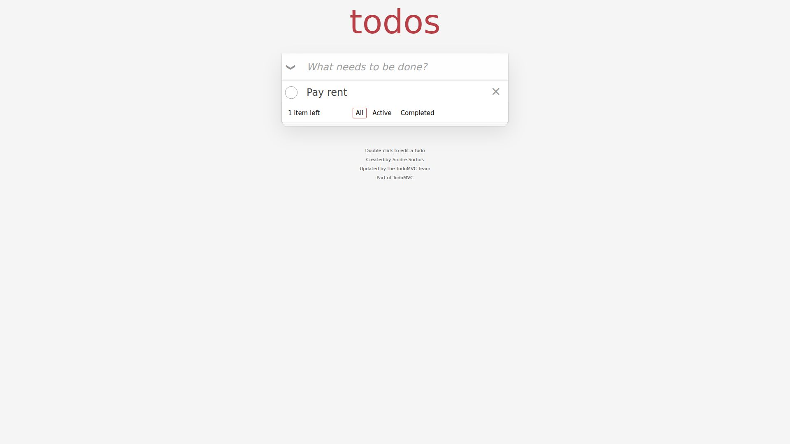

# Testing Ditto

Three layers, from fastest to most real.

## 1. Unit tests (`npm test`)

`test/kane.test.ts` feeds **real Kane CLI output** (captured NDJSON streams in `test/fixtures/`, home paths scrubbed) through the parser and checks the routing that the loop depends on:

- a confirmed product bug (`result_code 740`, `verdict.family: application_issue`) is a **mismatch**;
- a failure Kane blames on the test (`710`, `automation_bug`) is a **test issue**;
- a dropped browser (`510`, `environment_issue`) is an **error** that is retried, never counted;
- authored vs replayed runs (`author_decisions` / `replay_decisions`) and summed credits across markdown steps;
- Kane-designed `_test.md` files parse into steps with their `@verifies ac-N` links.

`test/console.test.ts` covers the console's logic: parity is counted only over behaviours the old app passes, the behaviour Claude fixed is found, rewinding the case for the replay shows only what had happened by then, and Kane's screenshots are grouped per test step with the failing step marked.

## 2. Type checks (`npm run typecheck`)

Strict TypeScript for the engine and the console.

## 3. Kane on Ditto's own console (`suites/console/`)

The console is checked the same way Ditto checks rewrites: plain-English `_test.md` files that Kane runs in a real browser.

```bash
npm run web:build && npm run ditto -- ui &            # serves http://127.0.0.1:4747
cd suites/console
kane-cli testrun run . --parallel 2 \
  --variables '{"start_url":{"value":"http://127.0.0.1:4747/?case=todomvc","secret":false}}' < /dev/null
```

| Test | What it proves |
|---|---|
| `first-screen-shows-the-verdict` | the question, the parity count and a test file with both apps' screenshots are on the first screen |
| `try-these-switches-behaviour` | picking a behaviour replaces the test file and highlights the chip |
| `screenshot-opens-enlarged` | every screenshot opens full size and closes again |
| `all-behaviours-table` | the table lists every behaviour and opens one at the top |

Latest run, against the deployed console (https://itssaharsh.github.io/ditto/, 2026-11-16, opening on the planted-bug run), saved in [`console-selftest.json`](console-selftest.json):

| Test | Result | Time | Credits | Kane's summary |
|---|---|---|---|---|
| `all-behaviours-table` | pass | 21 s | 0 | replay completed |
| `first-screen-shows-the-verdict` | pass | 20 s | 0 | replay completed |
| `screenshot-opens-enlarged` | pass | 128 s | 32 | The screenshot dialog opened successfully, but the replay's next click targeted another screenshot rather than the visible Close button. |
| `try-these-switches-behaviour` | pass | 70 s | 21 | opened the completed-todos scenario on itssaharsh.github.io |

Two tests replayed their earlier recordings for 0 credits. `try-these-switches-behaviour` was authored again because its text changed (the chip it clicks was already open on the new first screen, so it now picks another). `screenshot-opens-enlarged` healed: the replayed click hit a different screenshot, and Kane re-authored that step. The first run of these tests, earlier on 16 Nov, came back "unclear" on 3 of 4: Kane reported the console did the right thing but its own final check failed, and in one case the test expected "26/26" (a number left over from the design mock-ups) where the page showed the real 18/18. The test wording was fixed and all four passed.

## 4. The end-to-end run

`npm run ditto -- loop` is itself the integration test: Kane designs the suite, records the oracle, Claude Code ports the app, and the loop must end in parity with a final replay of every test on the rewrite. The recorded run is `cases/todomvc/case.json`; `npm run ditto -- status` prints its table.

A port that matches first time doesn't prove the tests would notice a regression, so the method has its own check: `npm run ditto -- mutate --config ditto.mutation.config.json`. A second Claude Code session plants bugs in a copy of the finished port and writes them down in `.ditto-work/` (outside the repository). Ditto then runs the normal loop with a fresh fixer session that sees only Kane's findings. The run passes only if the loop ends at parity again.

Recorded run (`cases/todomvc-mutation/case.json`, 16 Nov 2026): 3 bugs planted (Escape saves the edit; "0 item left"; mark-all looks checked while one todo is active). Kane confirmed differences on 2 behaviours on the broken build. Fix round 1 repaired Escape and the counter; Kane still flagged the counter test, now because mark-all couldn't complete the last todo; fix round 2 found the mark-all bug. Final replay: 18/18. 61 Kane runs, 40 of them pure replays, 480 credits; Claude Code reported $0.71 at API prices for the breaker and both fixer sessions. The commits are on the port's [`ditto/mutation-check`](https://github.com/itssaharsh/todomvc-react-port/commits/ditto/mutation-check) branch.

The run also exposed a flaw in Ditto. On the broken build, Kane's replays of `mark-all-checks-every-todo-in-all` and `two-active-todos-display-a-plural-counter` failed at their checks because of planted bug 3, then Kane's adaptive healing re-authored their steps until they passed, and Ditto took those passes. Ditto now takes a healed pass after a failed check (`assertion_failed`) only if a fresh Kane run, authored from the plain-English test without the old recording, passes too (`failedAtCheck` in `src/engine/loop.ts`, unit-tested in `test/kane.test.ts`).

To measure the change, the same broken build (commit `a150b02`, in a separate worktree) was checked again with `npm run ditto -- check --config ditto.recheck.config.json --label Re-check` (`cases/todomvc-recheck/case.json`): 6 behaviours confirmed different instead of 2 (4 of them from planted bug 3), 1 unsure instead of 3, 11 the same, and all 3 planted bugs confirmed in that one check. This is one re-run of a tool whose verdicts vary between runs: two of the extra differences came from tests that were "unsure" before and were settled by fresh authoring, not by the new rule. 37 Kane runs, 539 credits. Of the three healed passes the rule sent to a fresh run, two came back as confirmed differences (both bug 3) and one (`mark-all-reactivates-every-completed-todo`, whose recording trips on the React markup on every port) passed.

The fixer never saw the breaker's list: `npx tsx scripts/audit-fixer.ts cases/todomvc-mutation` reads Claude Code's own transcript of the fixer session and finds 24 tool calls, none of them touching the list or Ditto's work folder.

## 5. A behaviour no test covers

Parity only means something for the behaviours the suite checks. The mutation run showed where that ends. Fixing planted bug 1 (Escape saved the edit), Claude Code also removed a quirk of the old app: in the jQuery app, if you empty a title while editing and press Escape, the todo is deleted ([`app.js`](../fixtures/legacy-todomvc/app.js) checks for an empty value before it checks for Escape). The fixed port keeps the todo. No test in the suite does that, so Kane reported 18/18.

We spotted it reading the fixer's diff (commit `62752c5` on the [`ditto/mutation-check`](https://github.com/itssaharsh/todomvc-react-port/commits/ditto/mutation-check) branch), then asked Kane to look at both apps with one plain-English objective ([`scripts/edge-check.ts`](../scripts/edge-check.ts), results in [`edge-check.json`](edge-check.json)):

> Create a todo titled 'Pay rent' using the new-todo input. Double-click the 'Pay rent' label to edit it. In the edit field, select all of its text and delete it (Ctrl+A, then Backspace) so the field is completely empty, and only then press Escape; then assert that the todo list no longer contains a todo titled 'Pay rent'.

| App | Kane | Credits | Kane's summary |
|---|---|---|---|
| jQuery (old app) | pass | 20 | removed the “Pay rent” todo on the todo list |
| React port after the fixes | test_issue (`710`, Kane blames the check) | 16 | The check expected Escape to save an empty edit and remove the todo, but Escape cancels the edit and keeps the original todo. |

 

Kane's runs show the difference: the old app deleted the todo, the port kept it. Kane did not call that a bug in the port; it blamed the check (`710`), judging the port's behaviour right by the spec ("If escape is pressed during the edit, the edit state should be left and any changes be discarded"). So the fixer's change is arguably an improvement, but it is still a change users of the old app could notice, and Ditto only caught it because a person read the diff. The fix for the method is the obvious one: add the sentence to the suite, and the oracle decides which behaviour is the reference.
